<div align="center">

<picture>
  <source media="(prefers-color-scheme: dark)" srcset="docs/screenshots/banner-dark.png">
  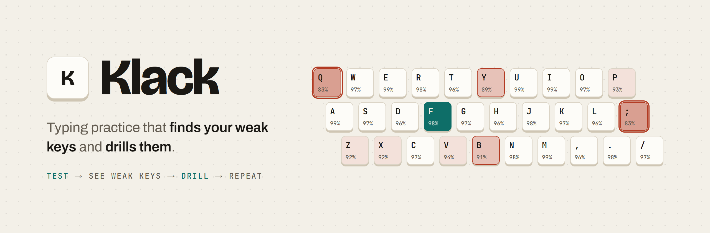
</picture>

<br>
<br>

[](https://klack-typing-trainer.vercel.app)
&nbsp;


**[Try it live](https://klack-typing-trainer.vercel.app)** &nbsp;·&nbsp;
[Features](#features) &nbsp;·&nbsp;
[Quick start](#quick-start) &nbsp;·&nbsp;
[How it works](#how-it-works) &nbsp;·&nbsp;
[Design](#design-system)

</div>

<br>

Most typing tests hand you a number. **62 wpm** does not tell you what to do next.

Klack records every keystroke against the character you were aiming for, ranks your keys by
how many mistakes they actually cost you, and turns the worst ones into a drill. One click
and you are practising the exact keys that slow you down.

<p align="center">
  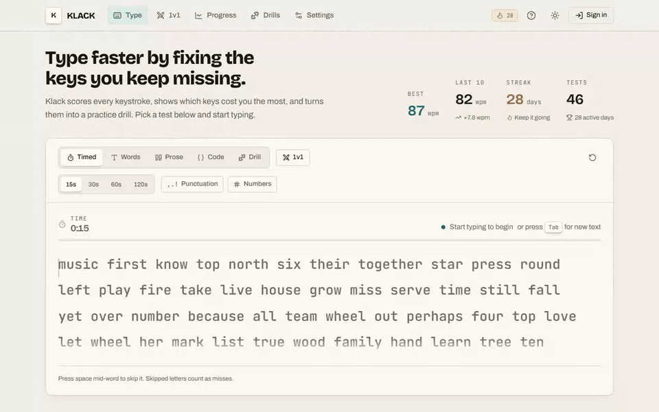
</p>

<p align="center"><sub>A 15 second timed test: distraction-free typing, then a second-by-second breakdown.</sub></p>

## The loop

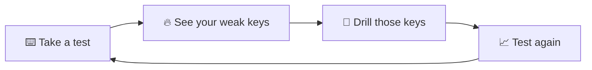

1. **Start typing.** The clock starts on your first keystroke, not before.
2. **Read the result.** Speed, accuracy, consistency, a pace chart and the keys you fumbled.
3. **Open Progress.** Speed over time and an accuracy heat map of the whole keyboard.
4. **Press _Drill these keys_.** Klack builds a drill from your five weakest keys and loads it.
5. **Repeat.** The streak counter and trend arrow tell you whether it is working.

No account is needed. Sign in only if you want your history in the cloud and on every device.

---

## Features

### ⌨️ A typing surface that gets out of the way

<picture>
  <source media="(prefers-color-scheme: dark)" srcset="docs/screenshots/type-dark.png">
  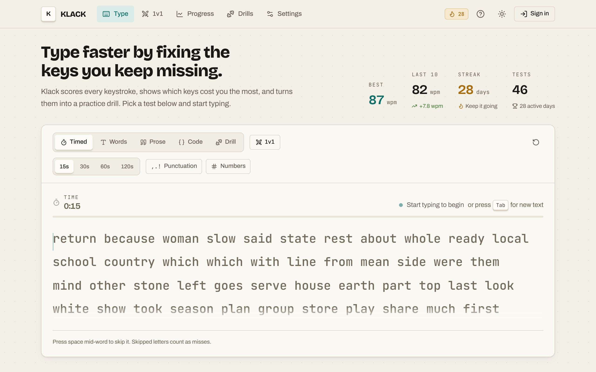
</picture>

Five test modes, all a click or a <kbd>Tab</kbd> away:

| Mode | What you type |
| --- | --- |
| **Timed** | 15, 30, 60 or 120 seconds of generated words |
| **Words** | A fixed count: 10, 25, 50 or 100 words |
| **Prose** | Full sentences with capitals and punctuation |
| **Code** | Brackets, operators and symbols from real code snippets |
| **Drill** | A saved drill, or one generated from your weak keys |

Generated text can include punctuation and numbers. Punctuation mode does not sprinkle commas
over random words: it uses complete, attributed sentences from public-domain classics.

The moment you start, the page clears. Setup controls, helper copy and the mobile tab bar
disappear, leaving the clock, live speed and four large lines of text. The caret glides between
characters on a single frame-synchronized animation loop.

<details>
<summary><b>See focus mode</b></summary>
<br>
<picture>
  <source media="(prefers-color-scheme: dark)" srcset="docs/screenshots/focus-dark.png">
  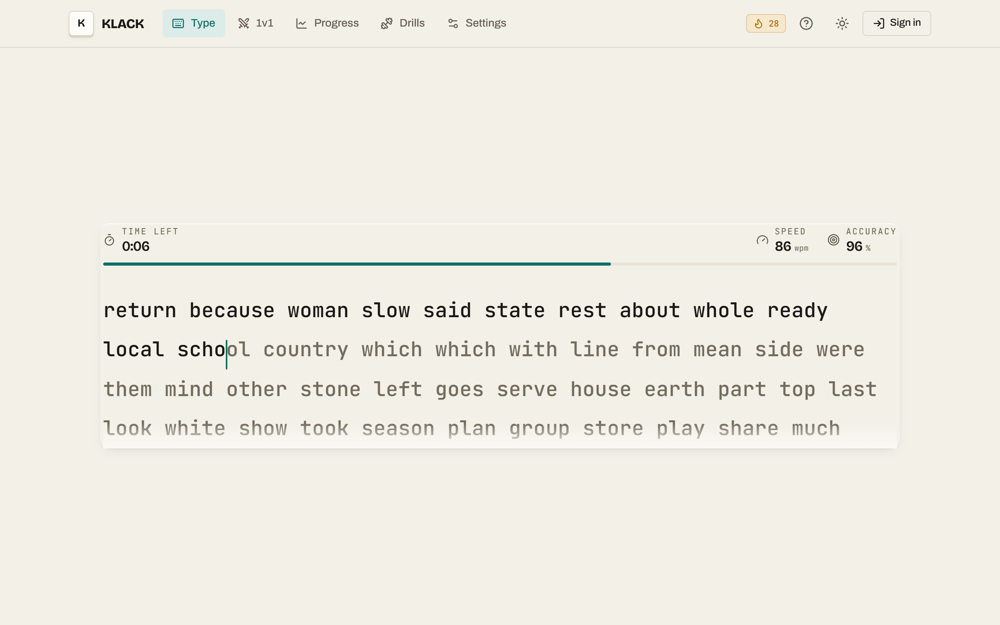
</picture>
</details>

### 📊 Results that explain the number

<picture>
  <source media="(prefers-color-scheme: dark)" srcset="docs/screenshots/result-card-dark.png">
  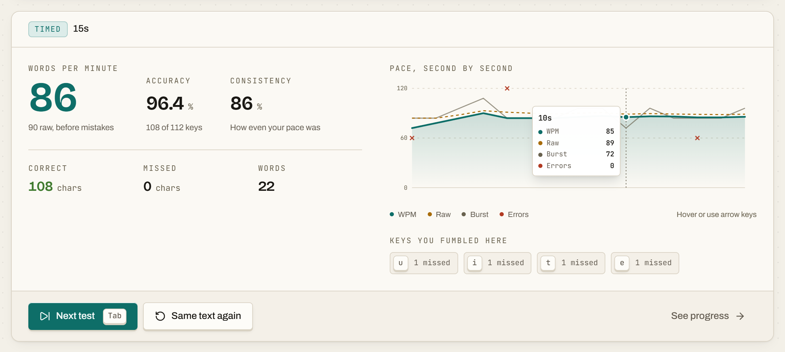
</picture>

- **Net WPM** from correctly typed characters (5 characters = 1 word)
- **Raw WPM** from every printable keypress, including the ones you corrected
- **Accuracy** per keystroke, so a fixed mistake still counts
- **Consistency**, the inverse coefficient of variation of your per-second speed
- **Pace, second by second**: hover any point for WPM, raw speed, burst and errors
- **Keys you fumbled here**, the per-test preview of what Progress will rank

### 📈 Progress you can act on

<picture>
  <source media="(prefers-color-scheme: dark)" srcset="docs/screenshots/speed-chart-dark.png">
  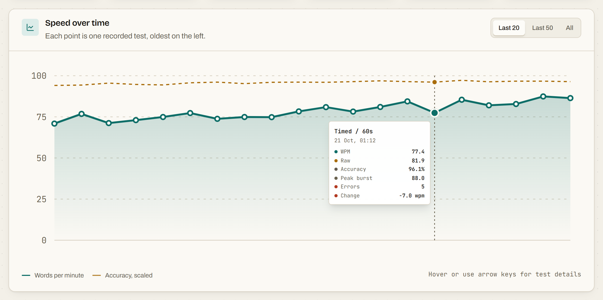
</picture>

<picture>
  <source media="(prefers-color-scheme: dark)" srcset="docs/screenshots/heatmap-dark.png">
  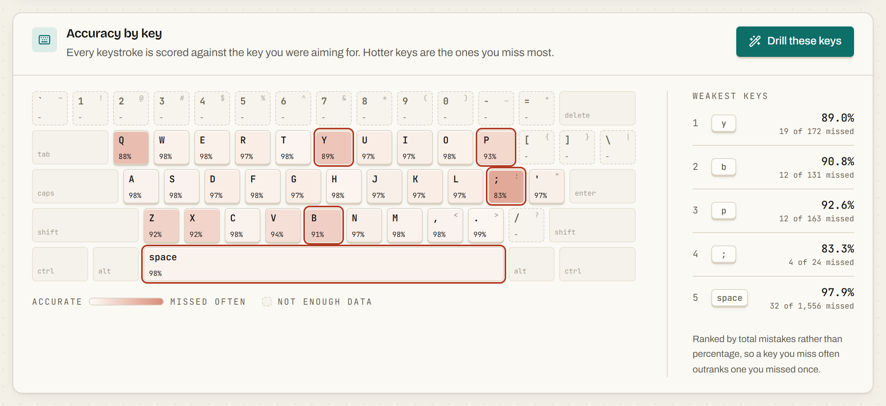
</picture>

- Six summary tiles: best speed, recent average, recent accuracy, streak, time and words typed
- Speed over time with an in-chart card for WPM, raw, accuracy, peak burst, errors and change
- **A keyboard heat map** where hotter keys are the ones you miss most, every key labelled with
  its accuracy as a number
- Weakest keys ranked by **total mistakes, not percentage**: a key you miss 30 times matters
  more than one you missed once in twelve tries
- A 28-day practice strip and a searchable, sortable, filterable test history

### 🎯 Drills

<picture>
  <source media="(prefers-color-scheme: dark)" srcset="docs/screenshots/drills-dark.png">
  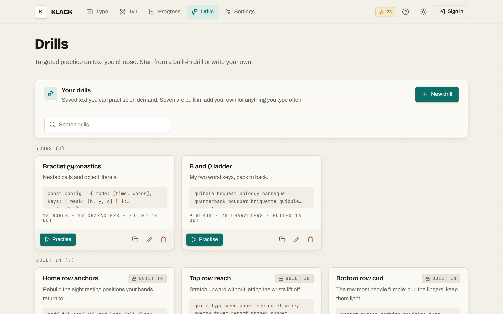
</picture>

- **Generated drills** that cycle through your weakest keys so no single key dominates
- Seven built-ins: home row, top row, bottom row, numbers, symbols, capitals, common pairs
- Create, edit, duplicate and delete your own, with validation
- Built-ins are read-only but can be duplicated into editable copies

### ⚔️ Live 1v1 races

Share an eight-character room code, both press Start, and race through **the exact same
passage** after **the same three-second countdown**. No account required. Your rival's progress
streams in live above your text.

<picture>
  <source media="(prefers-color-scheme: dark)" srcset="docs/screenshots/race-live-dark.png">
  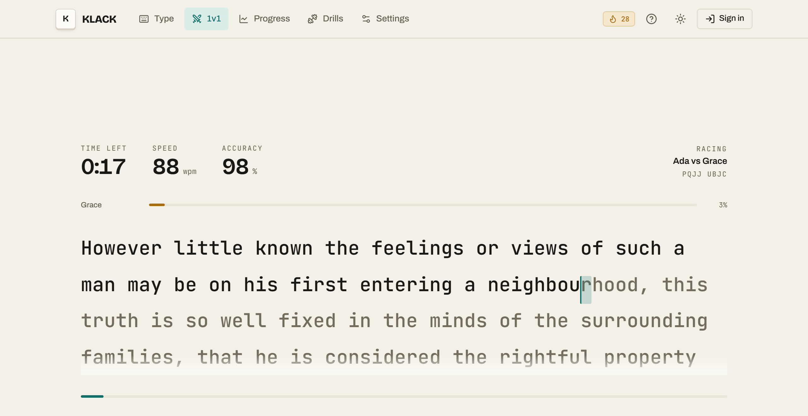
</picture>

<table>
  <tr>
    <td width="50%">
      <picture>
        <source media="(prefers-color-scheme: dark)" srcset="docs/screenshots/race-room-dark.png">
        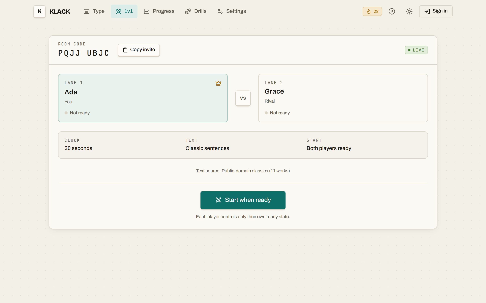
      </picture>
    </td>
    <td width="50%">
      <picture>
        <source media="(prefers-color-scheme: dark)" srcset="docs/screenshots/race-finish-dark.png">
        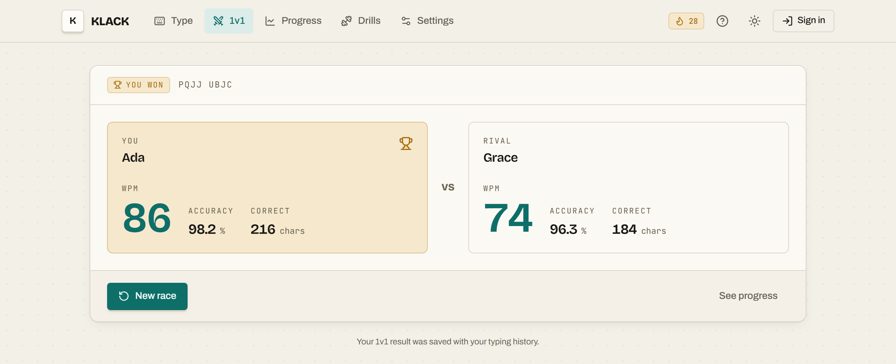
      </picture>
    </td>
  </tr>
  <tr>
    <td align="center"><sub><b>Lobby.</b> Two lanes, and each player readies themselves.</sub></td>
    <td align="center"><sub><b>Result.</b> Ranked by correct characters, then accuracy.</sub></td>
  </tr>
</table>

Rooms run on Supabase Realtime Presence and Broadcast. They are casual invite rooms, not ranked
infrastructure: there is no anti-cheat or matchmaking, and a room disappears when both players
leave. A finished race is saved to your history like any other timed test, so it still feeds
your weak-key analysis.

### 📱 Built for every screen

<table>
  <tr>
    <td align="center" width="25%">
      <picture>
        <source media="(prefers-color-scheme: dark)" srcset="docs/screenshots/mobile-type-dark.png">
        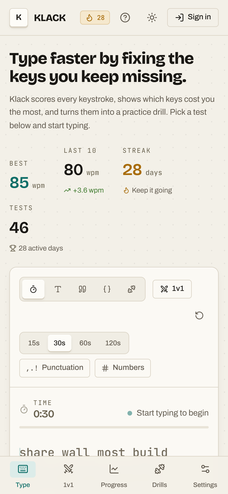
      </picture>
    </td>
    <td align="center" width="25%">
      <picture>
        <source media="(prefers-color-scheme: dark)" srcset="docs/screenshots/mobile-progress-dark.png">
        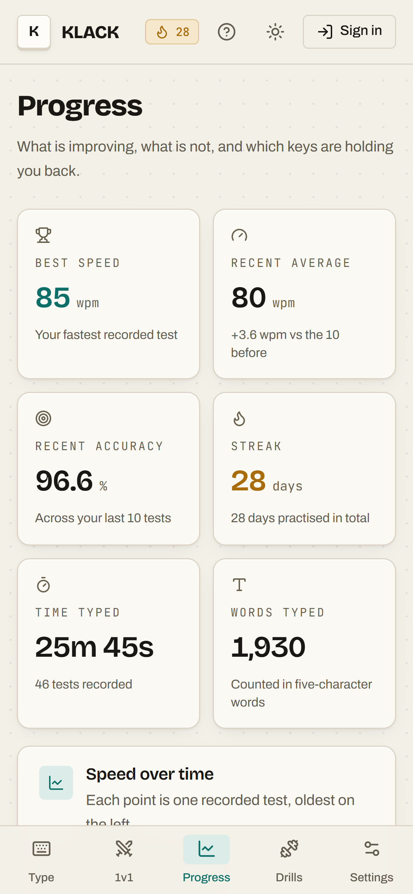
      </picture>
    </td>
    <td width="50%">

**Light, dark or system theme**, each designed separately rather than inverted.

**Three accents**: workshop teal, signal amber and blueprint cobalt.

**A bottom tab bar** on phones, and comfortable touch targets throughout.

**Reduce motion** in the app, independent of your OS setting.

<sub>Every screenshot in this README switches with your GitHub theme.</sub>

</td>
  </tr>
</table>

### ⚙️ Settings that actually change behaviour

<details>
<summary><b>See the settings page</b></summary>
<br>
<picture>
  <source media="(prefers-color-scheme: dark)" srcset="docs/screenshots/settings-dark.png">
  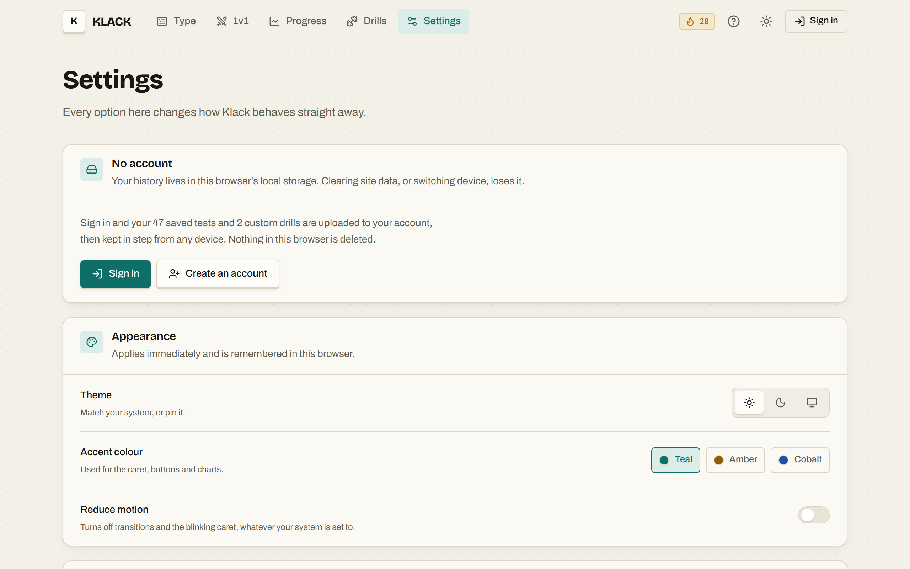
</picture>
</details>

- Default mode, test length and word count
- Punctuation and numbers in generated text
- **Stop on error**: wrong keys are rejected until corrected
- Hide live speed during a test
- Caret style (block, line or underline) and text size (regular or large)
- A synthesised keystroke click, generated with Web Audio, no audio files
- Export a JSON backup, import one, or reset everything

---

## Keyboard shortcuts

| Keys | What happens |
| --- | --- |
| <kbd>Tab</kbd> | Fresh text and a reset timer, without leaving focus mode |
| <kbd>Esc</kbd> | Reset the same text and leave focus mode |
| <kbd>Shift</kbd> + <kbd>Tab</kbd> | Move focus out of the typing field |
| <kbd>Backspace</kbd> | Step back one character |
| <kbd>Ctrl</kbd> + <kbd>Backspace</kbd> | Clear the current unfinished or incorrect word. A fully correct word is never erased. |
| <kbd>Space</kbd> mid-word | Skip the rest of the word. Skipped letters are struck through and count as misses. |
| <kbd>Enter</kbd> while paused | Resume the clock |

### Behaviour worth knowing

- ⏸️ The clock **pauses** when the test loses focus, the window blurs or the tab is hidden.
  Time away never counts against you. (Races are the exception: the shared clock keeps going.)
- 🧊 Tests under **3 seconds** or **10 keystrokes** are scored and shown, but never saved,
  so warm-ups do not skew your averages.
- 🚦 Reported speed is capped at 400 wpm. Anything beyond that is a clock anomaly, not typing.

---

## Quick start

Requires **Node.js 20.9** or newer.

```bash
git clone https://github.com/Tanjim-Islam/klack-typing-trainer.git
```

```bash
cd klack-typing-trainer && npm install
```

```bash
npm run dev
```

Open [http://localhost:3000](http://localhost:3000) and start typing. That is the whole setup
for guest mode: history lives in your browser's local storage and nothing else is required.

### Optional: accounts, cloud sync and 1v1

Sign-in, cloud history and live races need a [Supabase](https://supabase.com) project.

1. Copy `.env.example` to `.env.local` and fill in your project's values:

   ```bash
   NEXT_PUBLIC_SUPABASE_URL=https://your-project.supabase.co
   NEXT_PUBLIC_SUPABASE_PUBLISHABLE_KEY=sb_publishable_...
   # NEXT_PUBLIC_SITE_URL=https://your-domain.example   (recommended in production)
   ```

2. Run [`supabase/migrations/0001_init.sql`](supabase/migrations/0001_init.sql) against your
   database. It is idempotent, so re-running it is safe.
3. In the Supabase dashboard, add your app's URLs under **Authentication → URL Configuration**
   (for example `http://localhost:3000/**`), and enable the **Google** provider if you want
   "Continue with Google".

Without these variables Klack still runs. The sign-in pages explain that accounts are not
configured, and everything else keeps working locally.

| Command | What it does |
| --- | --- |
| `npm run dev` | Start the dev server with Turbopack |
| `npm run build` | Production build |
| `npm run start` | Serve the production build |
| `npm run lint` | ESLint |
| `npx tsc --noEmit` | Strict type check |

---

## How it works

### Accounts are optional, and local always comes first

| | Guest | Signed in |
| --- | --- | --- |
| **Source of truth** | This browser | Postgres on Supabase |
| **Local storage** | `klack.v1` | `klack.v1.u.<userId>`, as a cache |
| **Sign-in methods** | None needed | Email and password, or Google |

Every action updates the screen and local storage **immediately**, then syncs in the
background. Nobody waits on the network to see their score. If a write fails you get a toast,
and your local copy stays put.

The first time you sign in, your guest history is **uploaded to your account**, matched on
client-generated ids so syncing the same test twice can never create a duplicate. Nothing is
deleted: sign out and your guest data is exactly where you left it.

Every table is protected by **row level security**, so each account can only ever read and write
its own rows. A finished test, together with its per-key tallies, is written in **one atomic
database call**.

<details>
<summary><b>Architecture notes</b></summary>

<br>

```
 keystroke ─▶ lib/engine.ts    pure typing rules, no React, no DOM
                   │
                   ▼
              lib/analysis.ts  key scores, weak keys, generated drills
                   │
                   ▼
              lib/store.ts     the document, local-first, one module-level store
                   │
                   ▼
              lib/cloud.ts     translation to and from five Supabase tables
                   │
                   ▼
              Postgres + RLS   the real account boundary
```

**The engine is pure.** `lib/engine.ts` holds the typing rules as plain functions over an
immutable state object: `applyChar`, `applyBackspace`, `score`. No React, no DOM.
`components/type/use-typing-test.ts` wraps it with the clock, input listeners and result
plumbing.

**The store is a module, not a context.** Local storage cannot be read while rendering on the
server, and reading it in an effect means a render pass with the wrong data. `lib/store.ts`
keeps the document at module scope and exposes it through `useSyncExternalStore`: the server
snapshot is the defaults, and the saved document swaps in the moment the first component
subscribes. Actions are plain exported functions, so there is no provider to thread through.

**The typing surface writes to the DOM directly.** Caret position and line scrolling are
measurements, not state. The surface keeps current and target coordinates in refs and moves
the caret and text track together on one animation frame loop, so a new line scrolls in
without a wobble. A memoised `Word` component keyed on a compact per-character state string
means one keystroke re-renders one word, not a 1,200 character paragraph.

**Everything from outside goes through zod.** Local storage, imported backups, form input and
every row read back from Postgres. One unreadable result is dropped rather than failing the
whole history.

**Server-side identity is verified.** The session is read with `getUser()`, never trusted from
a cookie, and every post-login redirect passes an open-redirect guard.

</details>

<details>
<summary><b>Tech stack</b></summary>

<br>

| Choice | Why |
| --- | --- |
| **Next.js 16** (App Router, Turbopack) | Thin server-rendered shells, Server Actions for auth, and `proxy.ts` for session refresh. |
| **React 19** | `useSyncExternalStore`, `useActionState` and `useFormStatus`. |
| **Tailwind CSS 4** | Used through a semantic token layer in `app/globals.css`, never raw palette colours. |
| **Radix UI** | Accessible unstyled primitives for dialogs, menus, selects, switches and tooltips. Every pixel of styling is local. |
| **Supabase** | Postgres with row level security, email and Google auth, and Realtime channels for races. |
| **zod** | Validates every boundary: forms, storage, imports and database rows. |
| **lucide-react** | One consistent stroke-based icon set. |

**Deliberately not used:**

- **A chart library.** The charts are small hand-written SVGs on the same design tokens as
  everything else, with exact control over crosshairs, tooltips and narrow screens.
- **An animation library.** All motion is CSS, which also gets reduced-motion support for free.
- **A state library.** One module-level store read through `useSyncExternalStore` is enough.
- **An ORM.** Queries go through `supabase-js` against a hand-written schema and types.

</details>

<details>
<summary><b>Project structure</b></summary>

<br>

```
app/                 Routes, Server Actions, auth callback, global CSS and tokens
components/
  type/              Typing test, surface, live HUD, results panel
  race/              1v1 lobby, room protocol and race engine
  progress/          Progress view, tiles, history, weak keys panel
  drills/            Drills view and the create/edit dialog
  charts/            Hand-written SVG charts and the keyboard heat map
  ui/                Panel, Button, Dialog, Dropdown, Toast, Tooltip
lib/
  engine.ts          Keystroke processing and scoring
  analysis.ts        Key scores, weak keys, drill generation
  store.ts           The local-first, cloud-synced store
  cloud.ts           Supabase translation layer
  content.ts         Word lists, classic sentences, code, built-in drills
supabase/migrations/ The complete, idempotent schema with RLS
proxy.ts             Next.js 16 Proxy for session refresh
```

</details>

---

## Design system

**Direction: "keycap industrial".** Warm paper surfaces, machined edges, ink legends. Cards
carry a hard bottom edge and an inset highlight so they read as keycaps, and the page sits on a
faint dot grid.

| | |
| --- | --- |
| **Colour** | Every colour is a semantic token (`--canvas`, `--ink`, `--primary`, `--danger`, …). Light is warm cream, dark is warm charcoal, and both were designed separately. Accents swap the brand pair while status colours stay fixed, so "error" never becomes ambiguous. Muted text clears 4.5:1 contrast in both themes. |
| **Type** | **Bricolage Grotesque** for headings and big readouts, **Archivo** for UI text, **JetBrains Mono** for the typing surface, numbers and key legends, chosen so `1` `l` `I` and `0` `O` never blur together. Numbers use tabular figures so digits do not shuffle. |
| **Shape** | One spacing scale and a squarer radius scale (3/5/8/12/16px) to match the machined feel. |
| **Motion** | CSS only, with shared timings and one easing curve. Used for purposeful moments: panel reveals, the result rising in, caret travel and pressed-key feedback. |

### Accessibility

- Semantic landmarks, a skip link and one `h1` per page
- A visible focus ring on every focusable element, and no keyboard traps
- Destructive actions go through a confirmation dialog with focus on Cancel
- Form fields are label-linked with field-level errors, and input survives a failed submit
- State is never colour-only: skipped characters are struck through, and every heat-map key
  shows its accuracy as a number
- The hidden typing input is labelled and described by the full target text for screen readers
- Reduced motion is honoured both from the OS and from the in-app setting

---

<div align="center">

**Find your weak keys. Fix them. Get faster.**

[Start typing at klack-typing-trainer.vercel.app](https://klack-typing-trainer.vercel.app)

</div>
